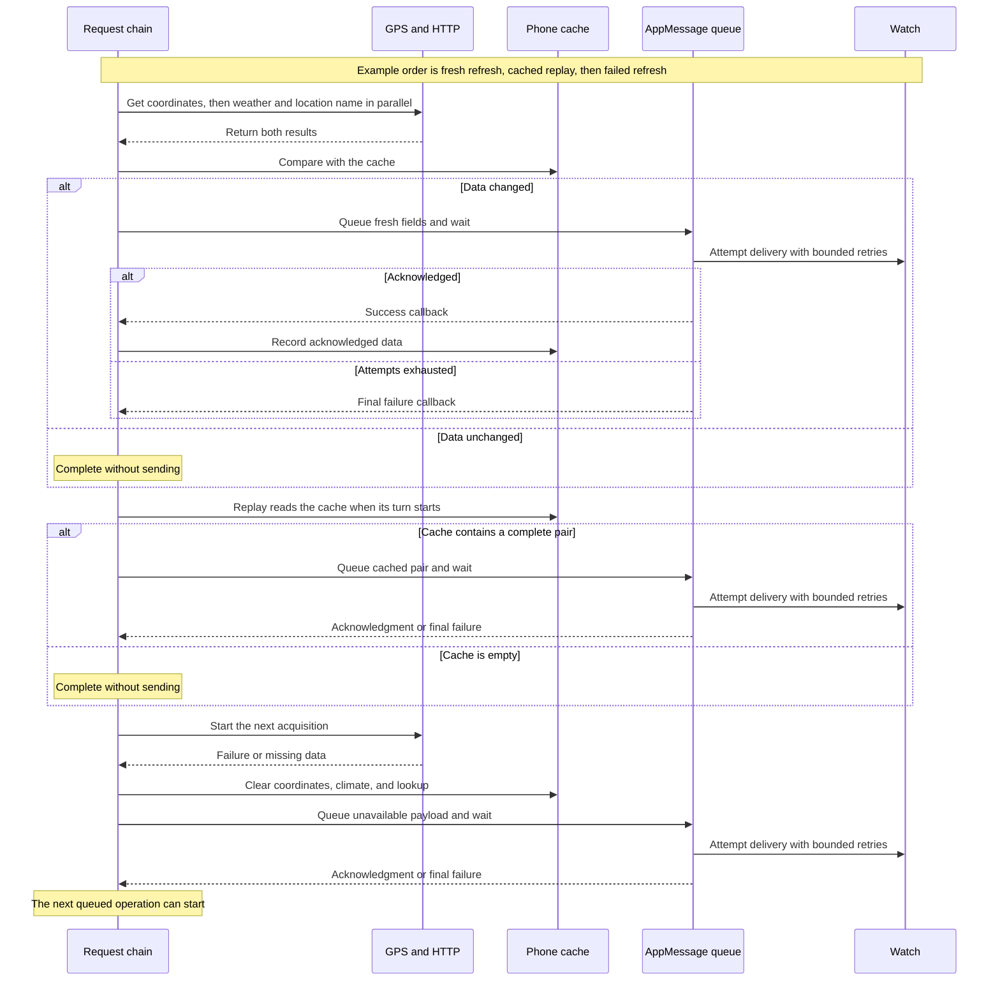

# Promise request chaining

How do fresh weather, cached replay, and unavailable updates share one order from acquisition through watch delivery? Each operation returns a Promise that settles when the next operation can safely start.

## Rules to retain

1. Define the completion event before writing the Promise.
2. Queue a function and read shared state when that function starts.
3. Use `new Promise` to adapt callbacks. Use `.then()` to order operations.
4. Return the Promise that covers all the work the next operation must await.
5. Provide a completion path for each normal branch, including a branch with no message.
6. Read handler arguments according to their contract. `.then()` receives the previous result. `.catch()` receives the rejection reason. The Promise executor receives `resolve` and `reject`.
7. Update acknowledged cache state on delivery success. Release the operation after either success or final failure.

## Lessons from the watchface

1. **Carry the fresh refresh through delivery.** The original fresh path did this correctly. It returned a Promise that waited for the AppMessage acknowledgment or final failure. Acknowledgment updated the cache before releasing the next operation.
2. **Queue the replay before reading the cache.** The original replay read the old cache while a newer message awaited acknowledgment. The delivery queue sent messages in submission order, so the old replay followed the fresh update. The reproduced sequence was 20°C → 21°C → 22°C → 21°C. Another 22°C reading was then suppressed because the phone already held 22°C in its cache. Passing the replay function to the request chain deferred the cache read until its turn and changed the sequence to 20°C → 21°C → 22°C → 22°C.
3. **Give the queue method and its stored Promise distinct names.** The first revision assigned a Promise to `this.chain` and also declared `chain()`. The instance property hid the method, so the call threw. The watchface now uses `startHere()` to append work.
4. **Return a Promise from the handler that should wait for it.** A `.then()` or `.catch()` handler can return a Promise and the next link waits for it. A `new Promise(executor)` executor runs immediately and JavaScript discards its return value. The nested replay wrapper resolved its inner Promise and left its outer Promise pending. One Promise tied to the delivery callbacks fixed it.
5. **Resolve when delivery reaches a final outcome.** Calling `resolve()` immediately after `updateClimateLocation()` released the request chain as soon as the send entered the delivery queue. Passing callbacks that resolve after acknowledgment or final failure moved completion to the right point.
6. **Complete the empty-cache branch.** If the cache is empty, there is no send and no delivery callback. Resolve immediately so the next request can start.
7. **Let clear own and return its Promise.** Applying the replay pattern to clear was the right reuse. Both adapt the same delivery callbacks. The intermediate `clearClimateAndLocation(resolve)` signature conflicted with `.catch(clearClimateAndLocation)`, which passes the rejection reason. The final helper creates its own Promise. The rejection handler adopts it directly, and the missing-data branch uses `return clearClimateAndLocation()`. An outer wrapper that calls clear and immediately resolves would release the chain early again.

## The complete flow

The request chain controls when each operation acquires data, reads the cache, or changes it. The AppMessage queue controls when prepared messages go to the watch and when delivery attempts end. The Promise returned by each operation connects those boundaries.



Startup sync and configuration call `kickoffUpdates()`. A changed interval or missing timer starts a connectivity probe. A successful probe queues a fresh refresh. Its `.finally(scheduleNextRefresh)` re-arms the timer after the operation finishes. A failed probe also re-arms the timer. With an unchanged interval and a set timer, kickoff queues a replay and keeps that timer. The timer can coexist with queued work, so the request chain governs ordering.

`Promise.all()` joins the weather and lookup results. If either rejects, the aggregate rejects while the other request can still finish. The network callbacks return results to the aggregate. Cache writes belong to the ordered operation, and a failed acquisition clears the cache before sending unavailable data.

## Canonical implementation

This standalone example keeps the watchface's two boundaries. It sends complete snapshots for clarity. The watchface builds changed-field payloads and uses a separate queue for control messages. The `send` function calls the success callback on acknowledgment or the failure callback after its last attempt. The example returns the original operation to the caller and stores a separate queue tail that recovers from unexpected rejection. Each caller can still handle the operation's error.

```javascript
const assert = require('node:assert/strict');

function createRequestQueue() {
  let tail = Promise.resolve();

  return function enqueue(run) {
    const operation = tail.then(() => run());
    tail = operation.catch(() => {});
    return operation;
  };
}

function createWeatherOperations(acquireSnapshot, send) {
  const enqueue = createRequestQueue();
  let cached = null;

  function deliver(payload) {
    return new Promise((resolve) => {
      send(
        payload,
        () => resolve(true),
        () => resolve(false)
      );
    });
  }

  function clear() {
    cached = null;
    return deliver({ temperature: null, location: '' });
  }

  return {
    refresh() {
      return enqueue(async () => {
        let next;
        try {
          next = await acquireSnapshot();
        } catch {
          return clear();
        }
        if (!next) {
          return clear();
        }
        if (
          cached &&
          cached.temperature === next.temperature &&
          cached.location === next.location
        ) {
          return;
        }
        if (await deliver(next)) {
          cached = next;
        }
      });
    },
    replay() {
      return enqueue(() => {
        if (cached) {
          return deliver(cached);
        }
      });
    },
  };
}

async function verify() {
  const pending = [];
  const readings = [21, 22, 22, 23, new Error('GPS unavailable'), null, 24];
  const weather = createWeatherOperations(
    () => {
      const reading = readings.shift();
      if (reading instanceof Error) {
        return Promise.reject(reading);
      }
      return reading === null ? null : { temperature: reading, location: 'Oakland' };
    },
    (payload, acknowledge, fail) => pending.push({ payload, acknowledge, fail })
  );

  async function nextSend(temperature) {
    await new Promise(setImmediate);
    assert.equal(pending.length, 1);
    const send = pending.shift();
    assert.equal(send.payload.temperature, temperature);
    return send;
  }

  await weather.replay();
  assert.equal(pending.length, 0);

  const first = weather.refresh();
  (await nextSend(21)).acknowledge();
  await first;

  const fresh = weather.refresh();
  const replay = weather.replay();
  const unchanged = weather.refresh();
  (await nextSend(22)).acknowledge();
  const pendingReplay = await nextSend(22);
  assert.equal(readings[0], 22);
  pendingReplay.acknowledge();
  await Promise.all([fresh, replay, unchanged]);
  assert.equal(pending.length, 0);

  const failedSend = weather.refresh();
  const afterFailure = weather.replay();
  (await nextSend(23)).fail();
  (await nextSend(22)).fail();
  await Promise.all([failedSend, afterFailure]);

  const failedAcquisition = weather.refresh();
  const missingSnapshot = weather.refresh();
  const emptyReplay = weather.replay();
  const recovered = weather.refresh();
  const failedClear = await nextSend(null);
  assert.equal(readings.length, 2);
  failedClear.fail();
  const nextClear = await nextSend(null);
  assert.equal(nextClear.payload.location, '');
  assert.equal(readings.length, 1);
  nextClear.acknowledge();
  (await nextSend(24)).acknowledge();
  await Promise.all([failedAcquisition, missingSnapshot, emptyReplay, recovered]);
  assert.equal(pending.length, 0);

  const enqueue = createRequestQueue();
  const rejected = enqueue(() => {
    throw new Error('operation failed');
  });
  const following = enqueue(() => 42);
  await assert.rejects(rejected, /operation failed/);
  assert.equal(await following, 42);
}

const deadline = setTimeout(() => {
  throw new Error('Request chaining did not complete.');
}, 2000);

verify()
  .then(() => console.log('Request chaining checks passed.'))
  .catch((error) => {
    console.error(error);
    process.exitCode = 1;
  })
  .finally(() => clearTimeout(deadline));
```

Run the JavaScript block from the repository root. The assertions control each delivery callback and check ordering, unchanged data, empty cache, failed delivery, both clear paths, and recovery after an unexpected rejection.

````sh
awk '/^```javascript$/ { code = 1; next } /^```$/ && code { exit } code' LessonsLearned/PromiseRequestChaining.md | node --unhandled-rejections=strict
````

## Read Next

- [Weather and location controller](../src/pkjs/weather_location.js) for the production request chain and cache rules.
- [AppMessage queue](../src/pkjs/app_message_queue.js) for acknowledgment, retry, and final failure callbacks.
- [Settings and Configuration](../docs/SettingsandConfiguration.md) for startup sync and refresh cadence.
