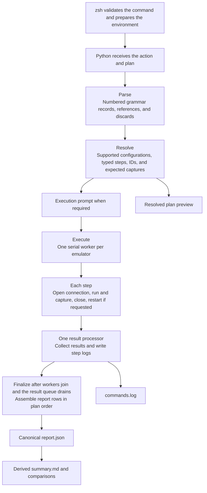

# Python lessons from the QA harness

How did the At A Glance QA harness grow from shell-driven checks into a Python pipeline? We settled on one concrete unit of work, the executable step, and gave each phase a clear contract. That let us add Matrix coverage, parallel emulator runs, and durable reports without making each layer understand the whole run.

## Rules to retain

- Name each handoff's caller, callee, input, output, and failure behavior.
- Keep skipped text, reported discards, and fatal errors distinct. Lines containing `#` are skipped. Recognized invalid items that can be isolated become discards.
- Keep the support matrix as the compatibility authority. A capability can be unsupported even when its emulator and display pair is valid.
- Derive identity from concrete inputs. Preserve plan order with dictionaries and assign step numbers at the scheduling boundary.
- Use an iterator for a stream, a dataclass for a record, and a context manager for a resource lifetime. The block reader, parsed step, and emulator connection are examples of those three jobs.
- Use ordinary Python forms such as `if not runs` and `enumerate(steps.values(), start=1)`. Stream compiler logs through the reader instead of building a list solely to iterate over it.
- Keep worker state scoped to one emulator and transport logs scoped to one step. Give file writes and result collection one owner.
- Validate artifacts at their boundary. Reconstruct report rows from JSON and check identity, counts, and typed argument fields. Use `commands.log` for failure diagnosis.
- Settle the smallest contract in STEPWISE, then implement one slice in TORTOISE. Check fixtures, serialization, runtime, and artifacts as applicable before calling the slice complete.
- Read the settled decisions before opening an audit finding. Keep accepted tradeoffs in place until new evidence changes the contract.

## How the architecture changed

1. **Hand off the run once.** Early designs had Python bootstrap, emit steps or structured state, and hand control back to zsh. Each crossing added another representation of the same run. The final launcher validates shell arguments, coordinates environment work, and passes the action and plan name to Python. Python owns plan validation, execution, and reports after that handoff. Shell environment commands can still delegate an operation to the Python Pebble adapter.
2. **Separate grammar from executable meaning.** A parser can identify a well-formed `STEP` without knowing whether it can run. Block readers consume a shared iterator of numbered lines and return grammar records, references, and diagnostics. The resolver handles expansion and compatibility. A concrete step constructor validates domain values. This replaced the temptation to check the same value in the parser, resolver, and executor. For example, a battery orientation token must have the right field name at parse time, become an integer at resolution, and satisfy the constructor's `0..1` invariant.
3. **Put repeated variation in the plan.** Repeating display in every step tied the stimulus to a particular run configuration. Moving `DISPLAYS` to the preamble let a Matrix reuse a `.steps` file across supported emulator and display pairs. The support matrix decides which pairs and capabilities can run. A Suite composes existing plans and tracks member identities so repeated or cyclic references do not trigger another traversal. The plan exposes discarded inputs before execution and prompts even with `--force` when it has discards.
4. **Use concrete execution facts as identity.** An insertion-ordered dictionary made the step identity useful for ordering, de-duplication, screenshot naming, and result joins. Build the ID from resolved inputs and stable screenshot intent. Keep counters, timestamps, paths, and results separate. The planner's order also survives concurrent completion because finalization builds report rows from the plan.
5. **Keep screenshot intent with the step.** An early suite-wide policy treated any screenshot-enabled member as enabling screenshots for the entire run. That changed what other members requested. The resolver now copies the source plan's policy to each concrete step and calculates expected counts. A typed step owns capture points. Bluetooth and `all` capture before and after changing connection state, so they expect two images when enabled. The executor counts what was actually captured.
6. **Use polymorphism where behavior differs.** The early design kept a generic step and deferred a hierarchy until it earned its place. Once capabilities needed different operation order, capture points, or restart behavior, concrete `PlanStep.run()` implementations removed dispatch logic from the executor. The capability factory selects the type. Constructor validation keeps dynamic construction readable without a parallel set of argument checks.
7. **Follow the connection lifecycle.** A restart inside the Bluetooth step could leave a live connection behind. The step now returns a restart signal. The executor exits the adapter's `with` block, which closes the WebSocket, then restarts the emulator before the next step on that worker. A fresh connection per step keeps ownership local. Synthetic waits and best-effort screenshots were deliberate choices because the Pebble operations lack completion notifications and this harness tests the watchface.
8. **Parallelize across independent emulators.** A serial executor was easy to reason about. Starting threads per step would have lost that property for a shared emulator. The threaded revision gives each emulator one worker and keeps that worker's steps in plan order. Workers send results and step-local log blocks through a `Queue`. One result processor collects them. Finalization uses plan order for the report, while `commands.log` preserves the diagnostic account of execution.
9. **Keep durable facts in one format.** Early reporting work had fragile readers and unclear ownership between runtime state and report output. The final contract makes `report.json` the durable authority. A typed reader validates the report and its counts. `summary.md` can be rebuilt from that JSON, and comparison reports derive from selected runs. A run's identity is the basename of its output folder. Filtered `asdict()` was accepted where it kept serialization explicit enough without separate transfer objects.
10. **Keep the harness focused on watchface coverage.** The portability discussion explored a generic AppMessage library. Pebble Tool already supplied an arbitrary AppMessage sender. We kept the watchface-specific contract because it gave us reusable plans, capability coverage, release checks, and comparable evidence. Reusable pieces such as the compiler database generator kept a narrow job.

## The four phases

The arrows follow one run. Validation and dry-run stop after resolution. View and compare consume existing reports without executing watchface steps.



| Phase | Owner | Handoff |
| --- | --- | --- |
| Parse | `qaplanparser.py` | Convert plan text to grammar records. Skip out-of-grammar lines, record invalid recognized items, and raise when structure prevents parsing. |
| Resolve | `qaplanresolver.py` | Expand plan references and supported configurations, build typed steps, and return an ordered `PlanDefinition` with discards. A valid plan has at least one executable step. |
| Execute | `qaplanexecutor_threaded.py` and `pebbleadapter.py` | Route numbered steps to emulator workers. Each worker returns a result with status, screenshot paths, and its logs. |
| Finalize | Executor, `qaharnessruntime.py`, and `qareportrenderer.py` | Join results to the plan, write JSON, render Markdown, and return the run status. |

## Settled decisions and current behavior

- **Duplicate steps.** The register calls for recording discarded duplicates. In the current resolver, two identical weather templates in one scenario collapse to one step with zero discards. Repeated Suite members have their own explicit discard handling.
- **Inspection imports.** The settled boundary calls for inspection imports to avoid Pebble Tool initialization. The current report import reaches the resolver and then the adapter, which initializes Pebble Tool. The example below therefore uses the existing harness environment even though it performs no emulator operations.

## Canonical example using the harness

The example uses production entry points for plan resolution, emulator grouping, typed report loading, and summary regeneration. It uses the checked-in canary report as captured evidence and writes the regenerated summary into a temporary directory. The Matrix assertions check planned coverage and order. The JSON assertions check that report data survives a round trip and retains the facts needed for rendering.

```python
import json
from contextlib import redirect_stdout
from io import StringIO
from pathlib import Path
from tempfile import TemporaryDirectory

from qaharnessruntime import ConsolidatedQARunOutputs
from qaplanexecutor_threaded import stratify_steps_by_emulator
from qaplanresolver import load_and_validate_plan
from qaresultinspector import write_summary_report


def verify_plan() -> None:
    with redirect_stdout(StringIO()):
        plan = load_and_validate_plan("qa-smoke")

    assert len(plan.execution_configs) == 6
    assert plan.step_count == 12
    assert plan.expected_screenshots == 18
    assert not plan.discarded

    lanes = stratify_steps_by_emulator(plan.steps)
    assert list(lanes) == ["emery", "chalk", "flint"]
    assert [step.step_number for step in plan.steps.values()] == list(range(1, 13))
    for emulator, steps in lanes.items():
        expected = [step for step in plan.steps.values() if step.emulator == emulator]
        assert steps == expected
        assert len(steps) == 4


def verify_report() -> None:
    fixture = Path("tools/harness_py/unittests/fixtures/reports/canary")
    data = json.loads((fixture / "report.json").read_text(encoding="utf-8"))
    run = ConsolidatedQARunOutputs.from_dict(data)
    assert run.run_id == run.output_folder.name == data["run_id"]
    assert run.step_count == 2
    assert run.resolved == {"expected_screenshots": 4, "captured_screenshots": 4}

    reloaded = ConsolidatedQARunOutputs.from_dict(json.loads(json.dumps(run.as_dict())))
    assert reloaded.as_dict() == run.as_dict()

    with TemporaryDirectory() as directory:
        summary_path = Path(directory) / "summary.md"
        write_summary_report(fixture, summary_path)
        generated = summary_path.read_text(encoding="utf-8")
    expected = (fixture / "summary.md").read_text(encoding="utf-8")
    assert generated.strip() == expected.strip()


verify_plan()
verify_report()
print("Harness plan and report checks passed.")
```

Run the embedded example from the repository root with Pebble Tool and the active SDK available.

````sh
awk '/^```python$/ { code = 1; next } /^```$/ && code { exit } code' LessonsLearned/PythonQAHarness.md |
  PYTHONDONTWRITEBYTECODE=1 PYTHONPATH=tools/harness_py uv run --python 3.13 python -
````

For an execution change, the next evidence is a real screenshot-enabled Matrix across multiple emulators. Confirm order within each emulator, one report result per step, and the expected screenshots. Inspect `report.json`, the regenerated summary, and `commands.log`. The example proves the plan and report handoffs with fixtures. The Matrix exercises transport and capture.

## Adjacent

- [Settled QA Harness Decisions](../qa/settled-decisions.md) records the project decisions that guided the revisions.
- [Promise request chaining](PromiseRequestChaining.md) covers the related problem of ordering asynchronous operations in PebbleKit JS.

## Read Next

- [QA Harness Implementation Flow](../qa/docs/QAHarnessImplementationFlow.md) maps the live modules, types, and call sites.
- [Writing Test Cases and Plans](../qa/docs/WritingTestCasesAndPlans.md) defines the executable grammar and fixtures.
- [Validation](../docs/Validation.md) describes the evidence required for a harness change.
