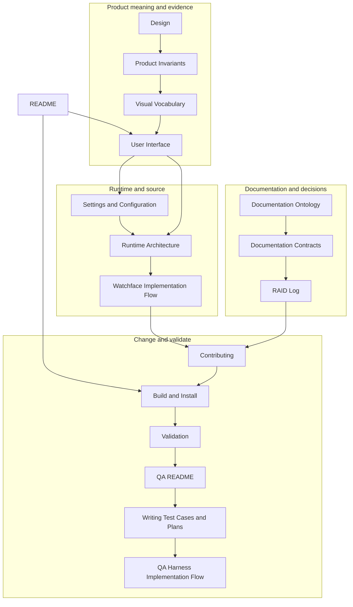

# Documentation Ontology

Use this map to find the canonical document for each _At A Glance_ question and follow the related reading path.

## Adjacent

- [DocumentationContracts](DocumentationContracts.md) defines document purposes, scope, and navigation rules.

## Ontology Invariants

1. One first-class concept has one canonical home.
2. The documentation set is complete when its first-class concepts have one clear owner.

This document owns the domain map and relationship graph. [DocumentationContracts](DocumentationContracts.md) owns document scope and the procedure for changing the set.

## Canonical Knowledge Domains

Place each concept in its canonical home. Other documents link to that home and explain only the context their readers need.

| Question | Canonical home | Class |
| --- | --- | --- |
| What is the product, and how do I get it? | [README](../README.md) | Entry point |
| Why does the product exist? | [Design](Design.md) | Prescriptive |
| What must remain true as it evolves? | [ProductInvariants](ProductInvariants.md) | Prescriptive |
| How do visual channels carry meaning? | [VisualVocabulary](VisualVocabulary.md) | Prescriptive |
| What does the current interface implement? | [UserInterface](UserInterface.md) | Evidence |
| Who owns runtime behavior and lifecycle? | [RuntimeArchitecture](RuntimeArchitecture.md) | Implementation |
| Which files implement those responsibilities? | [WatchfaceImplementationFlow](WatchfaceImplementationFlow.md) | Implementation |
| How do settings reach and affect the watch? | [SettingsandConfiguration](SettingsandConfiguration.md) | Implementation |
| How do I make and review a change? | [Contributing](Contributing.md) | Workflow |
| How do I build, install, and prepare a release artifact? | [BuildandInstall](BuildandInstall.md) | Workflow |
| What validation and evidence does a change need? | [Validation](Validation.md) | Validation |
| How do I operate the QA harness? | [QA README](../qa/README.md) | QA operations |
| How do I write scenarios, Matrices, and suites? | [WritingTestCasesAndPlans](../qa/docs/WritingTestCasesAndPlans.md) | QA grammar |
| How does the QA harness execute and report? | [QAHarnessImplementationFlow](../qa/docs/QAHarnessImplementationFlow.md) | QA implementation |
| Where does a documentation concept belong? | [DocumentationOntology](DocumentationOntology.md) | Governance |
| How do document scope and navigation stay consistent? | [DocumentationContracts](DocumentationContracts.md) | Governance |
| Which engineering decisions shaped the project? | [RAID Log](RAID_LOG.md) | Decision record |

## Document Relationship Graph

Arrows show primary reading paths. Each document's `Adjacent` and `Read Next` sections provide its local navigation; [DocumentationContracts](DocumentationContracts.md) records those connections.

## Emergent Properties

These topics stay within the canonical documents above:

- Product Identity
- Shared DNA
- Layout
- Display Modes
- Color
- Typography
- Platform Adaptation

Give a topic its own document only when it has an independent question, audience, and maintenance need.

## Read Next

- [Contributing](Contributing.md) for applying these ownership rules during a change.
