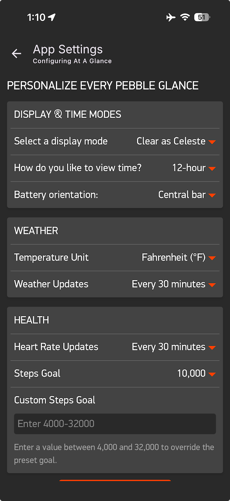

# Settings and Configuration

This document covers settings, configuration transport, message-key mapping, persistence, and validation for _At A Glance_. Use this document to understand:

- the canonical setting catalog
- settings defaults
- valid ranges and enums
- Clay field mapping
- `messageKeys` linkage
- PKJS normalization rules
- persisted-vs-ephemeral distinction
- runtime side effects
- validation obligations when a setting changes

**Key implementation details**

- Settings flow to and from the Clay configuration page through PKJS.
- `ataglance.c` loads settings during window creation. The message handler saves changed settings after runtime application.
- Settings are transported using AppMessage, then parsed and interpreted in C.
- Display is updated with information as long as it is within range.

## Adjacent

- [ProductInvariants](ProductInvariants.md) for the product properties settings must preserve.
- [VisualVocabulary](VisualVocabulary.md) for the visual rules affected by display settings.

## Settings Catalog

The runtime setting source of truth is `WatchfaceSettings` in `src/modules/settings.h`. On health-capable builds, there are seven persisted runtime settings.

| Setting | C field | Canonical key | Default | Valid values | Persisted | Runtime effect |
| --- | --- | --- | --- | --- | --- | --- |
| 1. Time format | `time_format` | `TIME_FORMAT` | `0` / `TIME_FMT_24` | `0` 24-hour, `1` 12-hour | Yes | Refreshes time text |
| 2. Temperature unit | `temp_unit` | `TEMP_UNIT` | `0` / `TEMP_UNIT_F` | `0` Fahrenheit, `1` Celsius | Yes | Refreshes climate text |
| 3. Display mode | `display_mode` | `DISPLAY_MODE` | `0` / `DISPLAY_MODE_LIGHT_MONOCHROME` | `0`, `1` on B/W; `0`, `1`, `2`, `3` on color | Yes | Repaints watch face |
| 4. Weather cadence | `weather_update_minutes` | `WEATHER_UPDATE_MINUTES` | `15` | `15`, `30`, `45`, `60` | Yes | PKJS applies the Clay value to its schedule; C persists its copy |
| 5. Heart-rate cadence | `hr_sample_minutes` | `HR_SAMPLE_MINUTES` | `15` | C accepts integers `10` through `120`; Clay offers `10`, `15`, `30`, `60`, `120` | Yes on `PBL_HEALTH` | Updates HealthService sample period |
| 6. Steps goal | `steps_goal` | `STEPS_GOAL` | `10000` | `4000` through `32000` | Yes on `PBL_HEALTH` | Refreshes steps display |
| 7. Battery orientation | `battery_orientation` | `BATTERY_ORIENTATION` | `0` horizontal on rectangular displays; `1` vertical on round displays | `0` horizontal, `1` vertical | Yes | Relayouts battery presentation |

Clay also exposes two settings-page inputs that are not canonical runtime settings:

| Clay input | Message key | Purpose | Crosses JS-to-C boundary |
| --- | --- | --- | --- |
| Steps goal preset | `STEPS_GOAL_PRESET` | Preset candidate for steps goal | No |
| Custom steps goal | `STEPS_GOAL_CUSTOM` | Optional custom override for steps goal | No |

PKJS collapses these two Clay inputs into the canonical `STEPS_GOAL` value before sending settings to C.

The settings catalog does not include weather data, location data, or one-shot health override keys. Those are AppMessage payloads, not persisted user settings.

## Source Of Truth Map

| Source | Owns |
| --- | --- |
| `package.json` | Pebble manifest `messageKeys` order and generated numeric IDs |
| `src/pkjs/config.json` | Clay settings page fields, labels, options, capability filters, and form defaults |
| `src/pkjs/index.js` | Clay result parsing, steps-goal normalization, saved cadence loading, and settings send |
| `src/pkjs/weather_location.js` | Weather/location polling, interval validation, and combined payload creation |
| `src/pkjs/app_message_queue.js` | Serialized sends and bounded retries for each queue |
| `src/modules/settings.h` | Runtime setting enums, defaults, validation macros, and `WatchfaceSettings` shape |
| `src/modules/settings.c` | Defaults application, persisted read/write, and persisted-value sanitization |
| `src/c/ataglance.c` | Settings loading, service subscriptions, and AppMessage callback registration |
| `src/c/ataglance_pebble_message_parser.c` | Tuple parsing and receipt/parse masks |
| `src/c/ataglance_pebble_message_handler.c` | Inbox sizing/opening, settings-save trigger, and HealthService cadence updates |
| `src/modules/watchface_runtime_boundary.c` | Runtime setting validation, mutation, repaint/refresh decisions |
| `src/modules/watchface.c` | Settings consumption during repaint and module refresh |
| [SettingsandConfiguration](SettingsandConfiguration.md) | Human-readable settings contract |

## Clay And PKJS Flow

Clay is configured in `src/pkjs/config.json` and opened from PKJS:

```text
Pebble showConfiguration event
  -> clay.generateUrl()
  -> user edits settings page
  -> webviewclosed event
  -> clay.getSettings(e.response)
  -> PKJS normalizes settings and applies the weather interval
  -> settings/control queue
  -> Pebble.sendAppMessage(dict)
```

The current settings page is shown here as evidence of the configuration surface, not as the visual specification:



Clay presents `BATTERY_ORIENTATION` as “Battery orientation:” with “Central bar” for horizontal and “Right Margin” for vertical. Capability-filtered fields default to horizontal on rectangular displays and vertical on round displays. Saved preferences override these defaults.

### PKJS Normalization

PKJS sends most Clay-backed settings directly after Clay maps their keys.

Steps goal is different:

```text
STEPS_GOAL_CUSTOM valid
  -> clamp custom to 4000..32000
  -> send STEPS_GOAL

else STEPS_GOAL_PRESET valid
  -> clamp preset to 4000..32000
  -> send STEPS_GOAL

else
  -> send STEPS_GOAL_DEFAULT
```

After computing `STEPS_GOAL`, PKJS deletes `STEPS_GOAL_PRESET` and `STEPS_GOAL_CUSTOM` from the outbound dictionary. C should not budget AppMessage inbox space for those two Clay-only inputs.

When Clay returns `WEATHER_UPDATE_MINUTES`, PKJS applies the interval. A changed interval triggers an immediate weather/location refresh and replaces the timer. An unchanged running interval keeps its timer.

PKJS owns the weather schedule. On the `ready` event, it reads `WEATHER_UPDATE_MINUTES` from Clay's `clay-settings` entry in `localStorage`. Missing or unreadable settings, an unparseable interval, or a nonpositive interval use the 15-minute default. The refresh controller accepts any positive parsed interval; C separately accepts only `15`, `30`, `45`, or `60`. The watch ignores `JS_READY` and sends no cadence synchronization message to PKJS. PKJS sends readiness in its own message because a parseable `JS_READY` tuple makes the C handler return before processing other tuples.

## AppMessage And Message-Key Contract

`package.json` owns the manifest-backed message-key list.

Current manifest-backed keys:

| #   | Key                      | Generated numeric ID | Role                            |
| --- | ------------------------ | -------------------- | ------------------------------- |
| 1   | `TIME_FORMAT`            | `10000`              | Runtime setting                 |
| 2   | `TEMP_UNIT`              | `10001`              | Runtime setting                 |
| 3   | `TEMPERATURE`            | `10002`              | Weather data                    |
| 4   | `WEATHER_CONDITION`      | `10003`              | Weather data                    |
| 5   | `IS_DAY`                 | `10004`              | Weather data                    |
| 6   | `WEATHER_UPDATE_MINUTES` | `10005`              | Runtime setting                 |
| 7   | `DISPLAY_MODE`           | `10006`              | Runtime setting                 |
| 8   | `HR_SAMPLE_MINUTES`      | `10007`              | Runtime setting on `PBL_HEALTH` |
| 9   | `STEPS_GOAL`             | `10008`              | Runtime setting on `PBL_HEALTH` |
| 10  | `STEPS_GOAL_PRESET`      | `10009`              | Clay-only input                 |
| 11  | `STEPS_GOAL_CUSTOM`      | `10010`              | Clay-only input                 |
| 12  | `MAYBE_CURRENT_LOCATION` | `10011`              | Optional location data          |
| 13  | `JS_READY`               | `10012`              | PKJS readiness control          |
| 14  | `BATTERY_ORIENTATION`    | `10013`              | Runtime setting                 |

Pebble assigns manifest-backed numeric message IDs from the `package.json` `messageKeys` order.

Generated C and JS artifacts may list keys in sorted-name order. That listing order is not the numeric assignment rule. Manual QA commands, harness helpers, PKJS, and C must follow the generated numeric mapping.

**Rules**

- Add new manifest-backed keys at the end unless a deliberate renumbering is being performed.
- Recheck generated key output after any `messageKeys` change.
- Update JS, C parsing, inbox sizing, harness helpers, manual QA commands, and docs in the same change.
- Do not assume generated file order is the same as numeric order.

### QA-Only One-Shot Keys

The current one-shot health keys are runtime-only constants:

| Key                                   | Numeric ID | Purpose                 |
| ------------------------------------- | ---------- | ----------------------- |
| `WATCHFACE_ONESHOT_MESSAGE_KEY_BPM`   | `10020`    | One-shot BPM override   |
| `WATCHFACE_ONESHOT_MESSAGE_KEY_STEPS` | `10021`    | One-shot steps override |

These are not Clay settings, not manifest-backed keys, and not persisted. They exist for focused QA and are consumed once by the health refresh path.

[Validation](Validation.md) owns the operational command examples for these keys. This document references them only to keep the settings, data, and QA payloads separate.

## Watch Runtime And Persistence Flow

### Startup

```text
main_window_load(window)
  -> settings_load(&s_settings)
       -> apply defaults
       -> read persisted data if present
       -> sanitize values
  -> watchface_create(window, &s_settings)
       -> module_create(params, relevant_loaded_setting)
  -> open AppMessage
```

### Settings receipt

```text
inbox_received_handler(iter, context)
  -> retain the previous heart-rate cadence on PBL_HEALTH
  -> return if a JS_READY sentinel is detected
  -> parse settings tuples
  -> parse weather and location tuples
  -> parse one-shot health tuples on PBL_HEALTH
  -> watchface_apply_received_data(&data, settings)
  -> save settings if persisted fields changed
  -> update HealthService sample period if HR cadence changed
```

## Runtime mutation

```text
watchface_apply_received_data()
  -> validate setting values
  -> mutate WatchfaceSettings
  -> request repaint or targeted refresh
```

Refresh effects:

| Setting                  | Runtime action                                                       |
| ------------------------ | -------------------------------------------------------------------- |
| `TIME_FORMAT`            | `WATCHFACE_UPDATE_TIME`                                              |
| `TEMP_UNIT`              | `WATCHFACE_UPDATE_CLIMATE`                                           |
| `DISPLAY_MODE`           | `WATCHFACE_REPAINT`                                                  |
| `BATTERY_ORIENTATION`    | `WATCHFACE_UPDATE_BATTERY_ORIENTATION`                               |
| `WEATHER_UPDATE_MINUTES` | Persisted in C; schedule update is managed in PKJS                   |
| `HR_SAMPLE_MINUTES`      | Persisted in C; HealthService sample period updated in `ataglance_pebble_message_handler.c` |
| `STEPS_GOAL`             | `WATCHFACE_UPDATE_HEALTH`                                            |

Persistence uses Pebble persistent storage key `2` and writes the full `WatchfaceSettings` struct only when a validated persisted field changes. Stored settings are sanitized on load.

## Validation Requirements

When a setting changes, validate the whole path that changed.

Minimum checks:

- `package.json` `messageKeys` order still matches expected numeric IDs.
- `src/pkjs/config.json` exposes the intended Clay field and capability filter.
- `src/pkjs/index.js` sends the intended canonical key.
- `src/c/ataglance_pebble_message_parser.c` parses the tuple.
- `src/c/ataglance_pebble_message_handler.c` budgets the inbox size and applies save/service side effects.
- `src/modules/settings.h` defines the default and valid range.
- `src/modules/settings.c` sanitizes persisted data correctly.
- `src/modules/watchface_runtime_boundary.c` validates and mutates the setting.
- The runtime refresh or repaint effect matches the setting's intended scope.
- Manual QA commands and harness helpers use the current numeric mapping.

Read [BuildandInstall](BuildandInstall.md) for build and install flows and associated commands, and [Validation](Validation.md) for emulator validation (using `pebble` commands or the watch face's QA harness).

## Change Checklist

For any settings change:

- Update `package.json` only when the AppMessage key set changes.
- Regenerate and inspect generated message-key output after key changes.
- Update `src/pkjs/config.json` for settings-page shape changes.
- Update `src/pkjs/index.js` for Clay normalization or scheduling changes.
- Update `src/modules/settings.h` and `src/modules/settings.c` for defaults, validation, persisted shape, or sanitization changes.
- Update `src/c/ataglance_pebble_message_parser.c` for tuple parsing.
- Update `src/c/ataglance_pebble_message_handler.c` for inbox sizing, save triggers, or cadence side effects.
- Update `src/c/ataglance.c` when startup loading or service subscriptions change.
- Update `src/modules/watchface_runtime_boundary.c` for runtime validation, mutation, repaint, or refresh behavior.
- Update [SettingsandConfiguration](SettingsandConfiguration.md).
- Update [Validation](Validation.md) only when validation flow changes.
- Update [UserInterface](UserInterface.md) only when visible settings evidence or visual consequences change.
- Run the relevant build and validation path, or record the validation gap.

## Read Next

- [RuntimeArchitecture](RuntimeArchitecture.md) for the runtime architecture.
- [UserInterface](UserInterface.md) for the visual consequences of settings.
- [BuildandInstall](BuildandInstall.md) describes build and install flows and associated commands.
- [Validation](Validation.md) for emulator validation and QA evidence.
