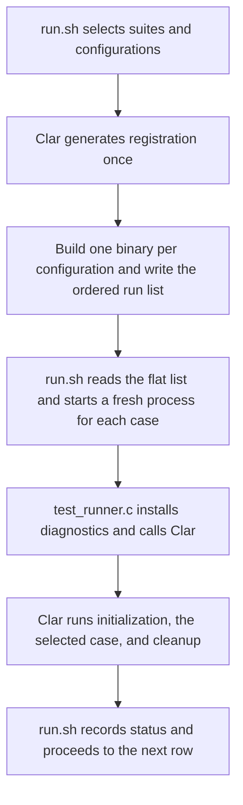

# Native C tests

These tests compile production C against small dependency replacements and run on the developer's computer. They validate core behavior and calculated geometry. Clang, Python 3, and a POSIX shell are required. No Pebble SDK, emulator, network connection, or real timer delays are needed.

## Adjacent

- [Validation](../../docs/Validation.md) owns validation-path selection, emulator checks, and operator evidence expectations.

## Run tests

The default runs every suite across the commit matrix:

```sh
npm run test:native
npm run test:native -- --matrix commit
```

| Platform | Geometry | Health |
| --- | --- | --- |
| Emery | 200x228 rectangle | Enabled |
| Chalk | 180x180 round | Enabled |
| Aplite | 144x168 rectangle | Disabled |
| Flint | 144x168 rectangle | Enabled |

`npm test`, `.githooks/pre-commit`, and `.githooks/pre-push` explicitly select `--matrix commit`. Each configuration builds one binary containing every selected suite. Each case runs in a fresh process using that binary. The terminal groups results by configuration and suite, followed by case names and `ok`, `fail`, or `skipped`. Skips include a reason. The command omits Clar's generic startup banners and preserves each process's exit status.

Run the complete matrix explicitly:

```sh
npm run test:native -- --matrix full
```

The full matrix builds all seven platform profiles with and without health: 14 binaries. It includes Basalt, Diorite, and Gabbro, covering all four supported screen geometries. Synthetic health combinations exercise conditional code; they do not claim shipping-device capabilities.

List cases or narrow a run:

```sh
npm run test:native -- --list
npm run test:native -- --suite settings
npm run test:native -- --suite settings --case legacy_migration --platform flint --health health
```

`--suite` defaults to `all`, which is reserved for the composite selection. `--case` selects one exact case and requires a specific suite. Unknown suites, missing cases, and invalid options fail before compilation. Focused selection builds only the chosen suite and its declared production dependencies.

`--platform` overrides the matrix's platform selection. It accepts `aplite`, `basalt`, `chalk`, `diorite`, `emery`, `flint`, `gabbro`, or `all`. `--health` overrides the matrix's health selection with `health`, `no-health`, or `both`. Without a health override, the commit matrix disables health on Aplite and enables it elsewhere; the full matrix selects both variants.

Enable memory and undefined-behavior checks:

```sh
npm run test:native -- --sanitize
npm run test:native -- --matrix full --sanitize
```

`NATIVE_SANITIZE=1` also enables sanitizers. A process crash or sanitizer abort stops that case's process. Later cases continue, including cases in the same suite, and the command returns failure. Ordinary assertion failures run case cleanup. A crash cannot guarantee cleanup inside the terminated process.

## Execution and ownership



| File | Responsibility |
| --- | --- |
| `run.sh` | Selection, suite-to-source table, compile profiles, shared builds, process isolation, and composite status. |
| `discover.py` | List or validate case names using Clar's parser before compilation. |
| `test_runner.c/.h` | Entrypoint, context, captured logs, skip reasons, and failure replay commands. The header also exposes Clar assertions. |
| `test_mocks.c/.h` | Dictionary inputs, storage, manual timers, messaging controls, watchface recording, and the exercised SDK geometry primitive. |
| `suites/<suite>.c` | Related test cases, optional lifecycle callbacks, and private scenario/assertion helpers. |
| `include/pebble.h` | The subset of SDK declarations needed by the compiled production code. |
| `vendor/clar/` | Unmodified upstream discovery, registration, assertions, case lifecycle, and result reporting. |

The runner's suite-to-source `case` table lists each suite's production dependencies as repository-relative paths. The runner combines the selected entries, removes duplicate paths, and compiles them with `test_runner.c`, the shared mocks, and Clar once per configuration. No production source has test-only branches. An unmapped suite prints a message and skips its source entry; discovery still selects its test cases. A suite that uses production functions needs a mapping for those functions to link.

The suites cover shared computations (`helpers`), tuple interpretation (`parser`), persistence and validation (`settings`), refresh/repaint dispatch (`runtime`), communications behavior (`comms`), and calculated bounds (`layout`). Communications tests compose the real handler, parser, runtime boundary, and settings implementation.

## Flat run list

Every scope becomes the same generated list: one case, one suite, or all suites. `run-list.tsv` lives under the build root and contains one headerless tab-separated row per selected case/configuration combination:

| Field | Purpose |
| --- | --- |
| Platform | Select the compiled device profile. |
| Health variant | Select `health` or `no-health`. |
| Suite | Identify the owning suite by filename. |
| Case | Select one exact test case within that suite. |

For example:

```text
emery	health	comms	open_retries
emery	health	comms	reinitialize_cancels_timer
```

The runner derives the binary path as `<build-root>/<platform>-<variant>/native_tests`. Clar runs inside that binary and selects the case, using its existing generated registration and lifecycle callbacks. The list stores no duplicate function pointers, binary paths, dimensions, or compiler flags.

Rows follow matrix platform order, health-variant order, sorted suite filenames, and source declaration order within each suite. The runner executes rows serially and prints each result before starting the next case. It does not mix results from different profiles.

All selected rows remain in the list if compilation fails. Their cases report `not run (build failed)`. A failed rebuild removes the old target binary so retained builds cannot execute stale code. A case failure or crash records its exact replay command and does not stop later rows.

## Add a case

Find the owning file in `suites/`. Add a non-static function named `test_<suite>__<case>(void)`. The suite name matches the filename without `.c`; the double underscore separates it from the case name. Each function takes no arguments and returns `void`.

For example, add this case to `suites/settings.c`:

```c
void test_settings__rejects_nonquarter_hour_interval(void) {
  WatchfaceSettings settings = {.weather_update_minutes = 60};
  cl_assert(!settings_set_weather_update_minutes(&settings, 16));
  cl_assert_equal_i(60, settings.weather_update_minutes);
}
```

Arrange inputs, call the production API, and assert the result. Use `cl_assert_equal_i(expected, actual)` for integers, `cl_assert_equal_s` for strings, `cl_assert_equal_p` for pointers, and `cl_assert(condition)` for predicates. Use `test_context("input=%d", value)` inside loops so failures identify the scenario. Use `test_skip("reason")` when a case does not apply to a configuration.

Keep the function declaration present in every configuration. Put conditional code inside the function and use `test_skip()` in the inactive branch; Clar's generator reads source without preprocessing platform conditions.

List the suite to confirm discovery, run the focused case, then run the commit matrix. Run the full matrix when changing compile-time behavior, persistence layout, geometry, mocks, or runner code.

## Organize a suite

Use the same order in every suite file:

1. Includes and a one-line suite description.
2. Shared types, constants, and file-local state.
3. A `// Clar lifecycle:` section containing any required callbacks.
4. A `// Suite helpers:` section containing private helpers, when needed.
5. A `// Test cases.` section containing the cases.

`test_<suite>__initialize(void)` runs before each case. `test_<suite>__cleanup(void)` runs afterward, including after an ordinary assertion failure. Keep these functions together near the top, before helpers and cases. Reserve suffixes beginning with `initialize`, plus `cleanup` and `reset`, for Clar lifecycle functions.

Omit empty callbacks. State explicitly when no lifecycle functions are needed. Reset dependencies where each scenario begins; avoid repeating that reset in a lifecycle callback. Private helpers run only when a case calls them. `start_comms_scenario(settings)` prepares a communications scenario; `receive_sync(settings)` builds and submits a sync message. Neither is called automatically by Clar.

Cleanup must tolerate partial initialization. The communications cleanup settles adapter state while fake timer handles remain valid, then clears simulated resources. Use `cl_check` when a cleanup assertion must allow remaining cleanup statements to run. Compose helpers rather than calling a test case as setup.

## Add a suite or mock

Create `suites/<suite>.c` and add its production dependencies to the suite-to-source `case` table in `run.sh`. Include `test_runner.h` for assertions and diagnostics, production headers for the APIs under test, and `test_mocks.h` when controlling dependencies. Use an empty branch for a suite that needs no production source files.

Choose suite names without overlapping underscore namespaces. Clar cannot select both `foo` and `foo_bar` reliably in one binary. The runner rejects that combination before building; either suite can still run on its own.

A suite named `calculations` could add this branch:

```sh
calculations)
  printf '%s\n' src/modules/substratum_computations.c
  ;;
```

The runner discovers the suite's C file and its Clar functions automatically. Adding a case to an existing suite requires no table edit unless it adds a production dependency. Add new dependency replacements to the existing sections in `test_mocks.c/.h`. Add SDK declarations to `include/pebble.h` only when exercised code requires them. Keep fake state fixed-size and expose direct controls and observations. Do not add a new mock framework or source-file boundary without a concrete need.

## Inspect calculated geometry

```sh
npm run test:native -- --suite layout --matrix full
npm run test:native -- --suite layout --case screen_bounds --platform chalk --bounds
npm run test:native -- --suite layout --platform gabbro --bounds --keep-build
```

The layout suite executes production layout and scaling calculations. Its catalogue holds names, references to calculated frames, and content-shape classifications. Expected outcomes come from containment rules and geometric relationships. There is no maintained table of expected coordinates.

Every prepared text, icon, battery, rule, and optional health frame gets positive-size and screen-boundary checks in both battery orientations. Failures identify the element, orientation, X/Y/width/height, screen size, and overflow on each edge. The checker collects all boundary violations before failing. Relationship checks cover battery fill containment and adjacent allocations. Scaling checks visit every reference-grid point within each placed icon frame.

Round displays add physical-circle checks using integer comparisons in doubled coordinates. Solid rectangles must fit the circle; the vertical round battery uses its fitted outer circle. Text and image frames can have unused corners. A partially intersecting frame is an observation; a frame entirely outside the circle fails. `--bounds` prints every rectangle, non-failing circle observations, and geometry summaries. Floating-point calculations only format radial-overflow diagnostics.

Within each battery orientation, items appear in ascending origin Y, then X, reading top to bottom and left to right; ties retain catalogue order. Each item shows `origin (x, y) | width W | height H | bottom-right (x + W, y + H)`. Screen-corner rows bracket the items using the selected platform's dimensions. Bottom-right coordinates denote the outer edges of the frame. With `--keep-build`, the output remains in `build/native-tests/<platform>-<variant>/layout.screen_bounds.log`.

These tests cover prepared geometry, not layer creation, occupied glyph pixels, font metrics, rasterization, stroke extents, or visual overlap. The operator or developer owns visual validation. [Validation](../../docs/Validation.md) owns the broader validation paths.

## Debug a failure

Clar reports the case, source location, and assertion details. Fatal assertion failures also print the current context, captured application/timer/send logs, and an exact replay command. Capture is bounded to 4,095 bytes and marks truncation. The runner prints a case replay command after any failed process, including one terminated by a signal.

Retain a focused build:

```sh
npm run test:native -- --suite layout --case screen_bounds --platform flint --keep-build
lldb -- build/native-tests/flint-health/native_tests -v -v '-slayout::screen_bounds$'
```

In LLDB:

```text
breakpoint set --name test_layout__screen_bounds
run
```

Builds use `-g -O0`. Each configuration directory contains its binary, `build.log`, compiler metadata, and unfiltered output in `<suite>.<case>.log`. Registration files are shared under `build/native-tests/registration`; `build/native-tests/run-list.tsv` records execution order. Normal runs remove temporary builds. The ignored `tests/native/compile_commands.json` contains commands from the selected successful builds. Use retained builds when debugging generated registration. Remove retained builds when finished.

## Check discovery and the runner

Use discovery directly to list one suite or validate an exact case:

```sh
python3 tests/native/discover.py --help
python3 tests/native/discover.py tests/native/suites/comms.c
python3 tests/native/discover.py tests/native/suites/comms.c open_retries
```

The script reads arguments and UTF-8 source, imports Clar's generator by file path, asks its parser for ordinary case names, applies the optional exact selection, and prints one `suite::case` per line in source order. It excludes lifecycle callbacks and writes no registration or build files. Errors go to standard error and return nonzero. The imported `Module` API is internal to Clar; check it when updating the dependency.

After changing runner code, discovery, matrices, lifecycle, or diagnostics, run:

```sh
python3 tests/native/verify_runner.py
```

These checks use a disposable copy, including a path containing spaces. They cover ordered run lists, default/full matrices, health flags, shared builds, compiler metadata, discovery, exact selection, retained builds, stale-binary rejection, failure replay, cleanup inside a failing process, continuation after a signal and another failed case, and geometry diagnostics. Dedicated probe cases are appended in the copy. Production source remains unchanged.

## Dependency boundary

Clar stays identical to the revision in [provenance](vendor/clar/UPSTREAM.md), which records its ISC license and known Python warning. Adopt dependency fixes through explicit upstream updates. Repository format commands exclude the vendor directory. Normal execution is offline.

Host compilation uses small enums and checks selected persistence/tuple representation contracts. It does not prove the complete SDK ABI or ARM calling conventions. The normal watchface build remains the target-toolchain check.
